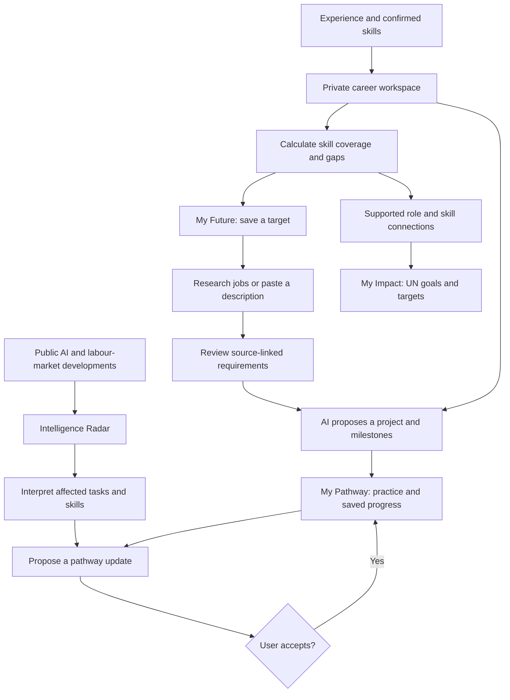

# Noka

**Navigate tomorrow's work, today.**

Noka helps students and working professionals turn changing job requirements into a personal career direction, a practical project and a reskilling pathway connected to sustainable development.

---

## Team Information

| Field | Details |
|---|---|
| Team Name | TMP |
| Team Domain | Domain 1 |
| SDG Track (1–17) | SDG 4 — Quality Education |
| Team Leader | Rohan |
| University | Asia Pacific University of Technology and Innovation(APU) |
| Number of Members | 1 |

## Links

| Resource | Link |
|---|---|
| GitHub Repository | https://github.com/Rohansarav/noka-ai |
| Demo Video | https://youtu.be/RInV1jgTsA8 |
| Replit Project | https://noka-ai.replit.app |
| Slide Deck | [Google Slides](https://docs.google.com/presentation/d/1nt3ttAfaMfgFsaSE0c9g5TsSWB2i7Mls/edit?usp=sharing&ouid=116410368141576376755&rtpof=true&sd=true) |

---

## Overview

### Problem

AI is changing the tasks inside jobs faster than people can translate those changes into learning decisions. Students and workers must piece together job advertisements, skills frameworks and AI news, then decide what to learn and build. Generic course recommendations rarely explain why a skill matters for a particular destination or how existing experience can help someone get there.

### Solution

**Your experience → your destination → real job requirements → your next project.**

Confirm your skills, choose a destination and let Noka research public job descriptions. Review the requirements, then receive a proposed project with milestones informed by your starting point and weekly learning time. Career evidence, alternative futures and SDG connections explain the reasoning behind your next step.

### Key Features

| Feature | What it helps you do |
|---|---|
| **My Future & Career Universe** | Explore connections between confirmed skills, career possibilities and gaps in an interactive graph. Choose a target with documented skill coverage. |
| **Job-grounded My Pathway** | Research a saved destination through Tavily or paste a job description. Turn reviewed requirements into a practical project and achievable milestones. |
| **Intelligence Radar & Opportunity Atlas** | Explore source-linked AI developments and career signals across demand, task transformation and talent shortages. Search reviewed evidence or clearly labelled synthetic scenarios. |
| **Pathway evolution** | Inspect proposed updates informed by relevant evidence, choose whether to apply them and preserve existing work. Labelled simulations demonstrate the update flow. |
| **The World Dial** | Explore how learning priorities could change under AI Acceleration, Governed AI and Human–AI Collaboration. |
| **My Impact** | Follow supported connections between careers, skills and UN Sustainable Development Goals and targets. |
| **Ask Noka** | Get explanations grounded in your private workspace through bounded, read-only tools, with visible execution activity. |


## Tech Stack

| Layer | Technology |
|---|---|
| Frontend | React, TypeScript, Vite, TanStack Query, React Flow |
| Backend | Python, FastAPI, Pydantic |
| Database | PostgreSQL, SQLAlchemy, Alembic; SQLite for local development |
| AI / Research | OpenAI structured outputs and tool calling; Tavily |
| Hosting / Dev | Replit (one frontend/API service) |
| Testing | pytest, Vitest, React Testing Library |

---

## Project Structure

```text
.
├── frontend/src/           # Screens, Career Universe and activity interfaces
├── backend/
│   ├── app/                # API, matching, research, pathways and SDG connections
│   │   └── agents/         # Bounded tool execution and activity events
│   ├── migrations/         # Versioned database migrations
│   └── tests/              # Backend behaviour and integration tests
├── data/                   # Source manifests, curation, fixtures and market baselines
├── scripts/                # Imports, startup and verification utilities
├── docs/                   # Product specification, methodology and reports
├── ml/                     # Supporting sector-level forecasting experiments
├── submission/             # Required submission documents
│   ├── SDC2026_TMP_Preliminary.pdf       # Preliminary submission
│   ├── SDC2026_TMP_TechDeclaration.pdf   # Technology declaration
│   └── SDC2026_TMP_Replit_POU.pdf        # Replit proof of use
├── .env.example            # Example environment variables
├── .gitignore
├── .replit                 # Replit run configuration
├── LICENSE
└── README.md
```

---

## Architecture

Noka combines **AI interpretation, deterministic calculations and traceable evidence**, each with a defined responsibility.




- **Evidence:** O\*NET requirements, public labour-market publications, job descriptions and UN goals provide context, with source and geography information.
- **Reasoning:** Python calculates documented skill coverage and gaps. OpenAI performs structured extraction and contextual interpretation. Tavily discovers public sources.
- **Action:** Users confirm skills, select targets, review requirements and accept pathway changes. Progress persists in the same workspace.
- **Delivery:** React communicates with FastAPI, which serves the frontend and API from one service backed by PostgreSQL. Replit configuration is included; public deployment is pending.

The same saved destination connects discovery, research, learning and impact. Recommendations can be traced to requirements, while new interpretations can become reviewable changes to an existing pathway.

### Evidence and Privacy

- **Reviewed evidence and synthetic data are clearly distinguished.** The bundled 13-career synthetic pack demonstrates every Atlas category. Its classifications, tasks and skills are authored assumptions inspired by published context.
- **Scenarios support planning.** Skill coverage describes recorded evidence; it does not establish hiring probability or professional qualification.
- **SDG connections explain relevance**, without claiming measured impact or guaranteeing a connection for every occupation.
- **Resumes never go to search providers.** AI profile analysis can send submitted experience to the configured model provider; original resumes are not retained.
- Source provenance and limitations are documented in [DATA_SOURCES.md](docs/DATA_SOURCES.md).

---

## How to Run

Requires **Python 3.11+, Node.js 22+, uv and pnpm 11.25.0**. Run from the repository root.

### Option 1 — Run on Replit (Recommended)

> Project and live-demo links will be added after deployment is verified.

1. Import this repository from `main` via **Create Repl → Import from GitHub**. The checked-in `.replit` builds React, installs Python dependencies, applies migrations and starts FastAPI on port 8000.
2. Open the **Secrets** tab (🔒) and add the server-side deployment secrets listed in `.env.example`:
   - `DATABASE_URL` (PostgreSQL; required in production)
   - `OPENAI_API_KEY`
   - `TAVILY_API_KEY`
   - `ENVIRONMENT=production`
   - `PUBLIC_ORIGIN` (must match the published HTTPS origin)
3. Populate the production database using the import commands in [Populate the database](#populate-the-database).
4. Click **Run**.

Research runs within the application process. Deployment lifecycle and worker continuity need verification before unattended research is enabled. Scheduled public-source refresh is configured separately.

### Option 2 — Run Locally

```sh
# 1. Clone the repository
git clone https://github.com/Rohansarav/noka-ai.git
cd noka-ai

# 2. Configure environment variables
cp .env.example .env            # Windows PowerShell: Copy-Item .env.example .env

# 3. Install dependencies
pnpm install --frozen-lockfile
uv sync --frozen

# 4. Apply database migrations
uv run alembic upgrade head
```

Keep `ENVIRONMENT=development` locally. Add `OPENAI_API_KEY` for AI features and `TAVILY_API_KEY` for web research. Select models available to your provider account using `.env.example`. Keep credentials out of source control.

#### Populate the database

```sh
uv run python scripts/import_data.py
uv run python scripts/import_careers.py
uv run python scripts/import_software.py --download
uv run python scripts/market_evidence.py import
uv run python -m backend.app.outlooks
uv run python -m scripts.register_context
uv run python -m scripts.propose_impact
```

Imports require public source downloads or verified caches. Impact proposals require recorded review before approval. A fresh database can have fewer reviewed connections than the demonstration workspace. See the [source documentation](docs/DATA_SOURCES.md) for import constraints.

#### Build and start

```sh
pnpm build
uv run python scripts/start.py
```

Open **http://localhost:8000**. For hot reload, run `pnpm dev` in another terminal and open **http://localhost:5173**.

---

## Run Tests

```sh
pnpm test
uv run pytest
```

Build before running integration tests. `/api/health` checks liveness; `/api/ready` checks database and migration readiness, plus the frontend bundle in production.

---

## How We Use Replit (Required)

- **Development:** Repository is configured to import and run on Replit via the checked-in `.replit` file.
- **Hosting:** The app is served as one frontend/API service (FastAPI on port 8000) with Replit Deployments. The live-demo link will be added once deployment is verified.
- **Secrets:** API keys and database credentials are stored in Replit Secrets, never in the code.

📄 Proof of use: `submission/SDC2026_TMP_Replit_POU.pdf`

---

## Challenges & Learnings

- **Challenges:** _Turning scattered career and AI information into useful guidance, connecting a person’s existing skills to real job requirements, and keeping recommendations trustworthy when evidence is incomplete or changing._
- **Learnings:** _Users need a concrete next project, not just a list of skills. Sources, dates and limitations make career guidance easier to trust, and people should review and control changes to their learning pathway._

## Future Improvements

- [ ] Pilot test with users to get feedback
- [ ] AI-Powered Adaptive Learning- Automatically refine reskilling pathways based on user progress, completed projects and evolving skill demands.
- [ ] Malaysia-Specific Labour Market Intelligence- Integrate Malaysian employment data and real-time job postings for localized career predictions.

---

## Team

| Name | Role | GitHub |
|---|---|---|
| Rohan | Team Lead / Full-stack / AI | [@Rohansarav](https://github.com/Rohansarav) |

---

## Submission Checklist

- [x] Team name, domain (Domain 1 / Domain 2) and SDG track filled in
- [x] Slide deck link added
- [x] Demo video link added
- [x] Replit used, with proof of use in `submission/`
- [x] Preliminary submission completed (`SDC2026_TMP_Preliminary.pdf`)
- [x] Technology declaration completed (`SDC2026_TMP_TechDeclaration.pdf`)
- [x] Submission files renamed with your team name
- [x] "How to Run" steps verified
- [x] No API keys or secrets committed to the repository

---

## License

This project is licensed under the Apache License 2.0.
