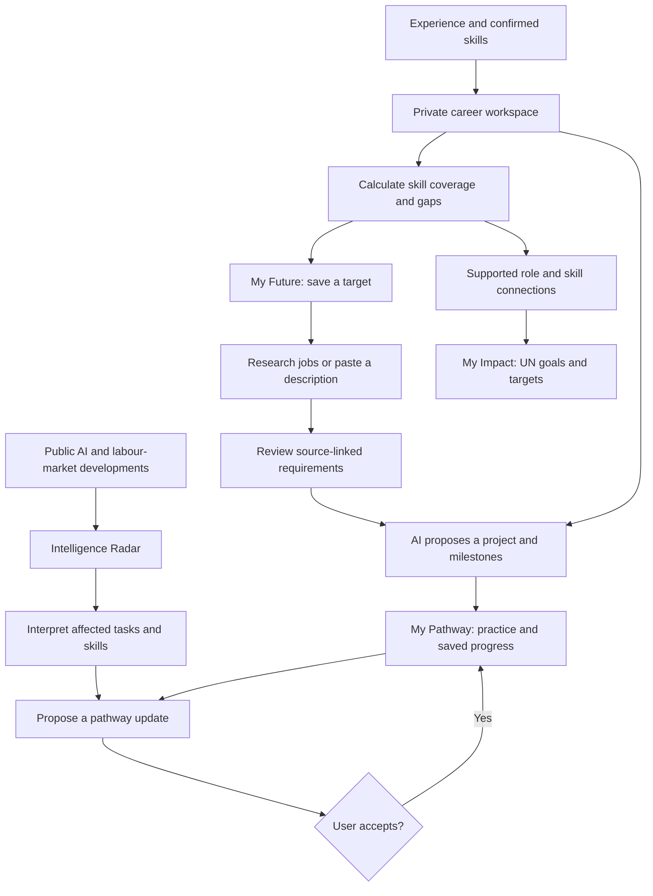

# Noka

**Navigate tomorrow’s work, today.**

Noka helps students and working professionals turn changing job requirements into a personal career direction, a practical project and a reskilling pathway connected to sustainable development.

[GitHub](https://github.com/Rohansarav/noka-ai) · Replit: coming soon · Live demo: coming soon

## The problem

AI is changing the tasks inside jobs faster than people can translate those changes into learning decisions. Students and workers must piece together job advertisements, skills frameworks and AI news, then decide what to learn and build. Generic course recommendations rarely explain why a skill matters for a particular destination or how existing experience can help someone get there.

## The solution

**Your experience → your destination → real job requirements → your next project.**

Confirm your skills, choose a destination and let Noka research public job descriptions. Review the requirements, then receive a proposed project with milestones informed by your starting point and weekly learning time. Career evidence, alternative futures and SDG connections explain the reasoning behind your next step.

## Key features

| Feature | What it helps you do |
|---|---|
| **My Future & Career Universe** | Explore connections between confirmed skills, career possibilities and gaps in an interactive graph. Choose a target with documented skill coverage. |
| **Job-grounded My Pathway** | Research a saved destination through Tavily or paste a job description. Turn reviewed requirements into a practical project and achievable milestones. |
| **Intelligence Radar & Opportunity Atlas** | Explore source-linked AI developments and career signals across demand, task transformation and talent shortages. Search reviewed evidence or clearly labelled synthetic scenarios. |
| **Pathway evolution** | Inspect proposed updates informed by relevant evidence, choose whether to apply them and preserve existing work. Labelled simulations demonstrate the update flow. |
| **The World Dial** | Explore how learning priorities could change under AI Acceleration, Governed AI and Human–AI Collaboration. |
| **My Impact** | Follow supported connections between careers, skills and UN Sustainable Development Goals and targets. |
| **Ask Noka** | Get explanations grounded in your private workspace through bounded, read-only tools, with visible execution activity. |

## Architecture: one connected career journey

Noka combines **AI interpretation, deterministic calculations and traceable evidence**, each with a defined responsibility.



- **Evidence:** O*NET requirements, public labour-market publications, job descriptions and UN goals provide context, with source and geography information.
- **Reasoning:** Python calculates documented skill coverage and gaps. OpenAI performs structured extraction and contextual interpretation. Tavily discovers public sources.
- **Action:** Users confirm skills, select targets, review requirements and accept pathway changes. Progress persists in the same workspace.
- **Delivery:** React communicates with FastAPI, which serves the frontend and API from one service backed by PostgreSQL. Replit configuration is included; public deployment is pending.

The same saved destination connects discovery, research, learning and impact. Recommendations can be traced to requirements, while new interpretations can become reviewable changes to an existing pathway.

## Evidence and privacy

- **Reviewed evidence and synthetic data are clearly distinguished.** The bundled 13-career synthetic pack demonstrates every Atlas category. Its classifications, tasks and skills are authored assumptions inspired by published context.
- **Scenarios support planning.** Skill coverage describes recorded evidence; it does not establish hiring probability or professional qualification.
- **SDG connections explain relevance**, without claiming measured impact or guaranteeing a connection for every occupation.
- **Resumes never go to search providers.** AI profile analysis can send submitted experience to the configured model provider; original resumes are not retained.
- Source provenance and limitations are documented in [DATA_SOURCES.md](docs/DATA_SOURCES.md).

## Tech stack

| Layer | Technology |
|---|---|
| Frontend | React, TypeScript, Vite, TanStack Query, React Flow |
| Backend | Python, FastAPI, Pydantic |
| Database | PostgreSQL, SQLAlchemy, Alembic; SQLite for local development |
| AI and research | OpenAI structured outputs and tool calling; Tavily |
| Hosting | Replit configuration for one frontend/API service |
| Testing | pytest, Vitest, React Testing Library |

## Run locally

Requires **Python 3.11+, Node.js 22+, uv and pnpm 11.25.0**. Run from the repository root.

```sh
git clone https://github.com/Rohansarav/noka-ai.git
cd noka-ai
cp .env.example .env
pnpm install --frozen-lockfile
uv sync --frozen
uv run alembic upgrade head
```

On Windows PowerShell, use `Copy-Item .env.example .env` instead of `cp`.

Keep `ENVIRONMENT=development` locally. Add `OPENAI_API_KEY` for AI features and `TAVILY_API_KEY` for web research. Select models available to your provider account using `.env.example`. Keep credentials out of source control.

### Populate the database

```sh
uv run python scripts/import_data.py
uv run python scripts/import_careers.py
uv run python scripts/import_software.py --download
uv run python scripts/market_evidence.py import
uv run python -m backend.app.outlooks
uv run python -m scripts.register_context
uv run python -m scripts.propose_impact
```

Imports require public source downloads or verified caches. Impact proposals require recorded review before approval. A fresh database can have fewer reviewed connections than the demonstration workspace. See the [source documentation](docs/DATA_SOURCES.md) for import constraints.

### Start and test

```sh
pnpm build
uv run python scripts/start.py
```

Open **http://localhost:8000**. For hot reload, run `pnpm dev` in another terminal and open **http://localhost:5173**.

```sh
pnpm test
uv run pytest
```

Build before running integration tests. `/api/health` checks liveness; `/api/ready` checks database and migration readiness, plus the frontend bundle in production.

## Replit

**Project and live-demo links will be added after deployment is verified.**

Import this repository from `main`. The checked-in `.replit` builds React, installs Python dependencies, applies migrations and starts FastAPI on port 8000.

Configure PostgreSQL and server-side deployment secrets: `DATABASE_URL`, `OPENAI_API_KEY`, `TAVILY_API_KEY`, `ENVIRONMENT=production` and `PUBLIC_ORIGIN` matching the published HTTPS origin. Populate the production database using the import commands above. Production requires PostgreSQL.

Research runs within the application process. Deployment lifecycle and worker continuity need verification before unattended research is enabled. Scheduled public-source refresh is configured separately.

## Project structure

```text
frontend/src/           Screens, Career Universe and activity interfaces
backend/app/            API, matching, research, pathways and SDG connections
backend/app/agents/     Bounded tool execution and activity events
backend/migrations/    Versioned database migrations
backend/tests/         Backend behaviour and integration tests
data/                  Source manifests, curation, fixtures and market baselines
scripts/               Imports, startup and verification utilities
docs/                  Product specification, methodology and reports
ml/                    Supporting sector-level forecasting experiments
.replit                Replit build and startup configuration
.env.example           Environment variable template
```

## Three-minute demo

1. Confirm a profile and explore transferable skills in **My Future**.
2. Save a target and research its **real job requirements**.
3. Review requirements and open the proposed **project and milestones**.
4. Inspect a labelled **pathway-update simulation** and demonstrate preserved progress.
5. Explore supported **SDG connections** in My Impact.

## Team and submission

| Field | Details |
|---|---|
| Team name | To be confirmed |
| Team domain | To be confirmed against official domain definitions |
| Suggested primary SDG track | SDG 8 — Decent Work and Economic Growth |
| Team leader | To be confirmed |
| University | To be confirmed |
| Members | To be confirmed |
| Slide deck | Coming soon |
| Demo video | Coming soon |

## Next steps

- Verify the Replit deployment and publish demo links.
- Expand reviewed occupation-level evidence and SDG connections.
- Improve durable background processing for research and updates.
- Evaluate requirement extraction and project usefulness with students and workers.
